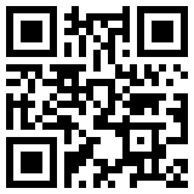
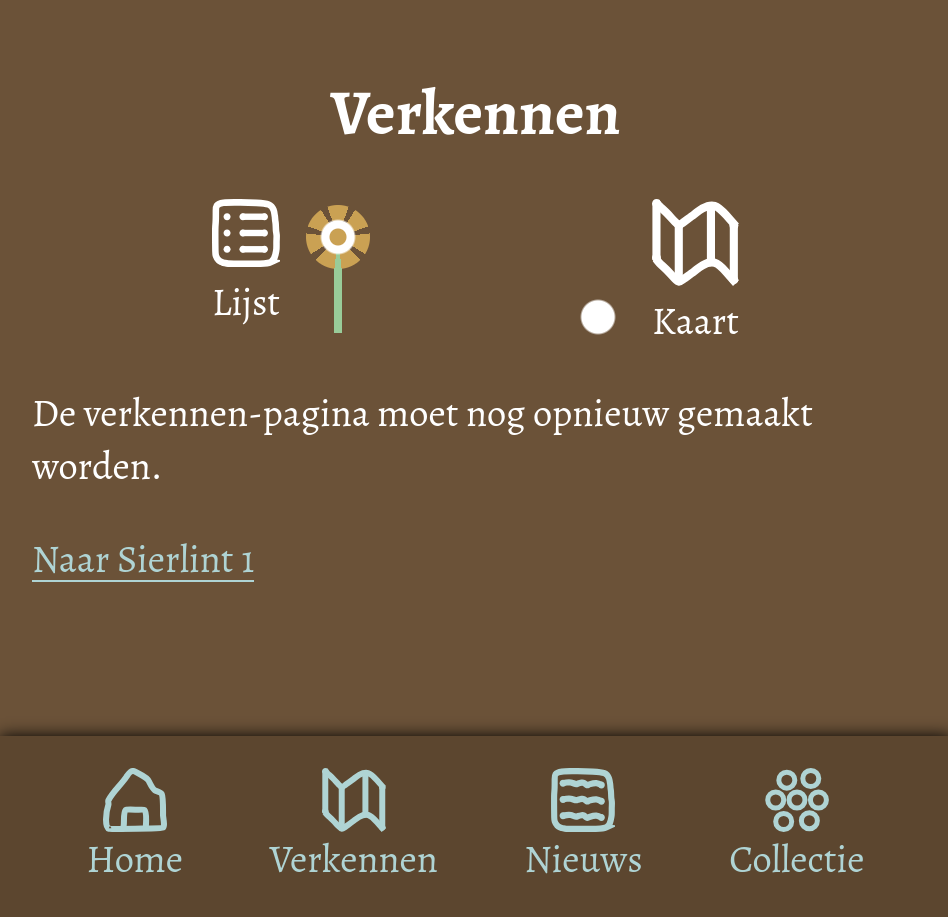
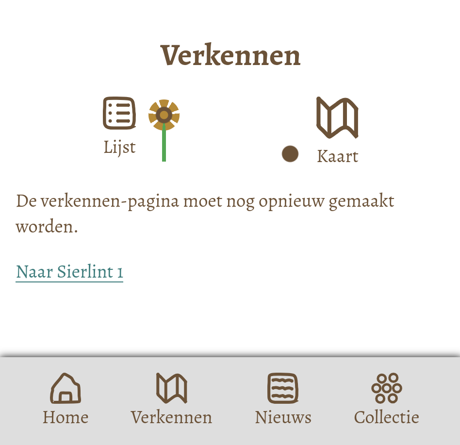
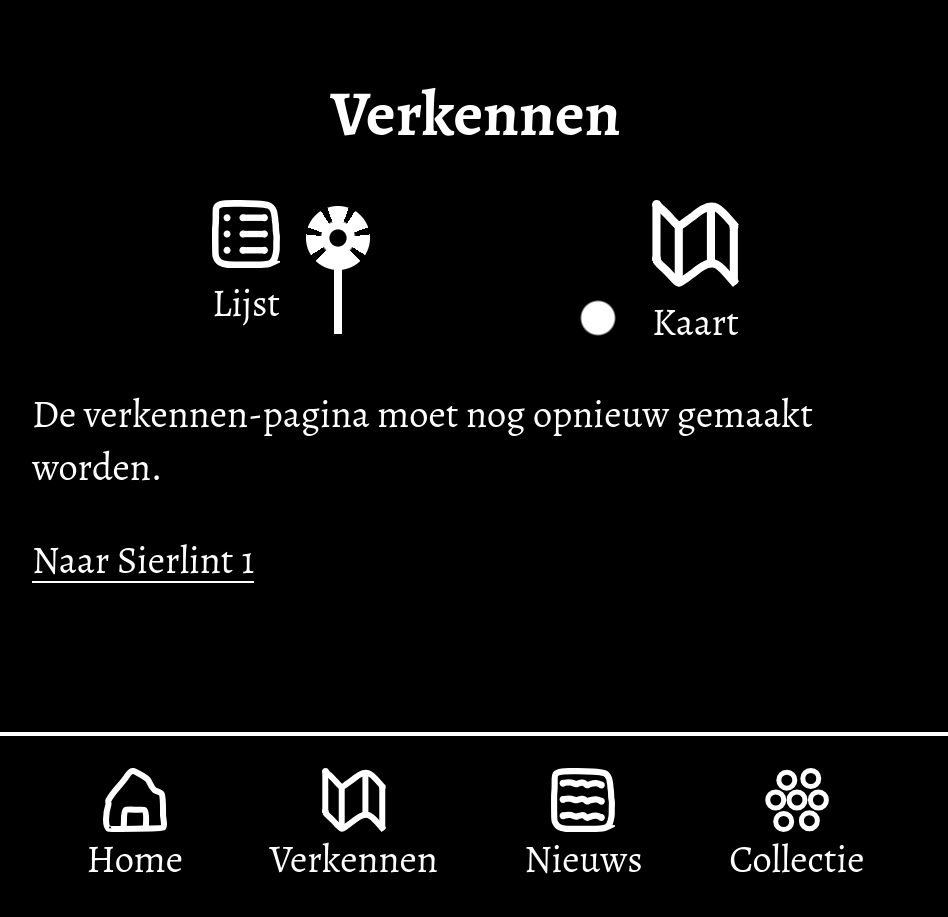
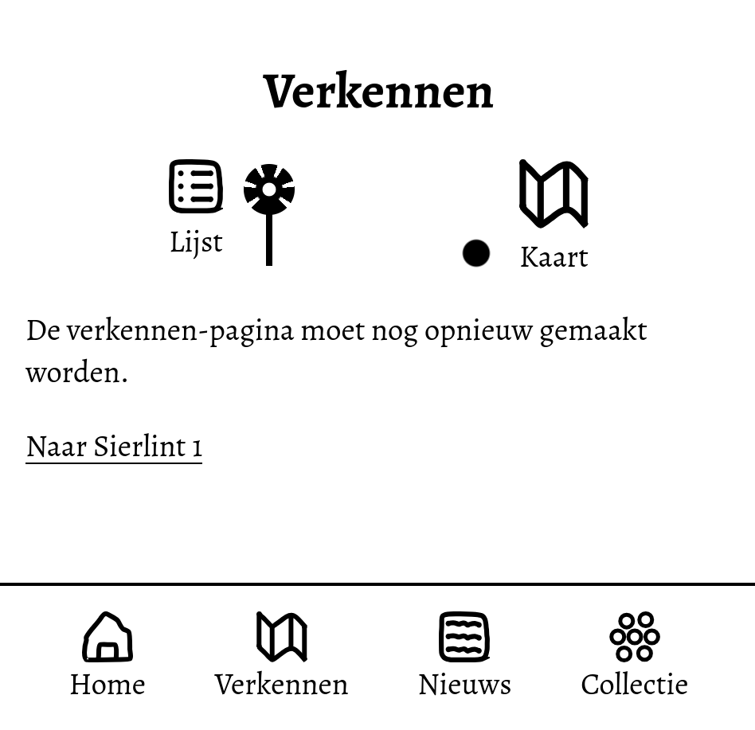
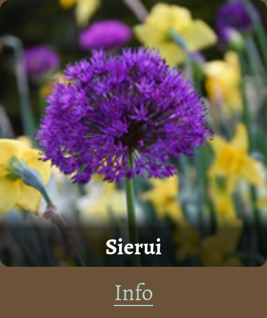
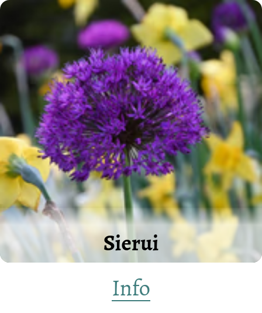
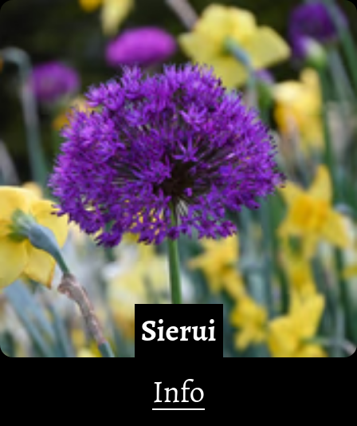
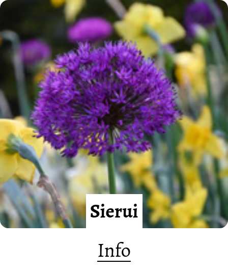

# Accessible Website

Ontwerp en maak voor een opdrachtgever een website toegankelijk volgens WCAG richtlijnen.

De instructie van deze leertaak staat in [WIKI](https://github.com/fdnd-task/all-human-accessible-website/wiki)

## Inhoudsopgave

  * [Beschrijving](#beschrijving)
  * [Kenmerken](#kenmerken)
  * [Bronnen](#bronnen)
  * [Licentie](#licentie)

## Beschrijving
Deze readme is nog helemaal niet af. 

[Link naar de webpagina](https://edu.nl/vmpun).

### Kleurenschema's 
Er worden vier nieuwe kleurenschema's gebruikt. Er zijn schema's voor lichte-modus, donkere modus, 
lichte modus hoog contrast en donkere modus hoog contrast. 

 
 *Donker schema*

 
 
 *Licht schema*

 
 
 *Donker hoog contrast*

 
 
 *licht hoog contrast*

### Tekst bovenop afbeelding
Op de Verkennen-pagina kan je momenteel alleen navigeren naar het gebied Sierlint 1. 
Daar worden afbeeldingen getoond van de planten die in het gebied groeien. De naam van
een plant wordt bovenop diens afbeelding getoond. Er worden twee methodes gebruikt 
uit [dit smashing-magazine-artikel over tekst bovenop een afbeelding](https://www.smashingmagazine.com/2023/08/designing-accessible-text-over-images-part1/).

Staat hoog-contrast uit, dan wordt er een gradiënt gebruikt die een stukje gedeeltelijk transparant is
en dan geleidelijk overgaat naar
volledig transparant (zodat de afbeelding daar volledig te zien is). De tekst verschijnt in het gedeeltelijk transparante gedeelte. Deze methode
heet [Scrim Overlay in het smashing-magazine-artikel](https://www.smashingmagazine.com/2023/08/designing-accessible-text-over-images-part1/#text-with-scrim-overlay). 

*Tekst bovenop afbeelding: donker*

*Tekst bovenop afbeelding: licht*

Staat hoog-contrast aan, dan krijgt de tekst een volledig ondoorzichtige achtergrond. 
Deze methode heet [Strips/Highlight in het smasing-magazine-artikel](https://www.smashingmagazine.com/2023/08/designing-accessible-text-over-images-part1/#strips-highlight-technique).

*Tekst bovenop afbeelding: donker hoog contrast*

*Tekst bovenop afbeelding: licht hoog contrast*

<!-- In de Beschrijving staat hoe je project er uit ziet, hoe het werkt en wat je er mee kan. -->
<!-- Voeg een mooie poster visual toe 📸 -->
<!-- Voeg een link toe naar Github Pages 🌐-->

## Kenmerken
<!-- Bij Kenmerken staat welke technieken zijn gebruikt en hoe. Wat is de HTML structuur? Wat zijn de belangrijkste dingen in CSS? Wat is er met Javascript gedaan en hoe? Misschien heb je een framwork of library gebruikt? -->

## Bronnen
* [Smashing-magazine-artikel over tekst bovenop een afbeelding](https://www.smashingmagazine.com/2023/08/designing-accessible-text-over-images-part1/)

## Licentie
This project is licensed under the terms of the [MIT license](./LICENSE).
